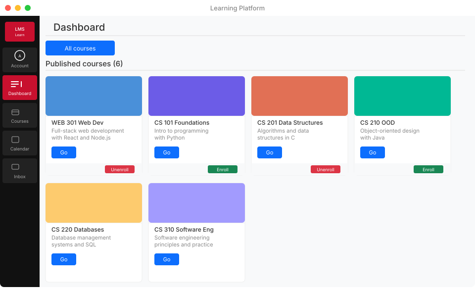

# Learning Management System


A full-stack learning management system: faculty build courses out of modules,
assignments and quizzes, and students enroll, work through the content and take
the quizzes. A Next.js and Redux front end talks to a Node.js, Express and
MongoDB REST API, with session-based sign-in and hashed passwords.



## What it does

- **Accounts** - sign up, sign in and edit a profile; users have a role
  (student, faculty or admin), and the interface adapts to it.
- **Courses** - a dashboard of courses to browse, enroll in or leave; faculty
  create, edit and delete them.
- **Modules and assignments** - organize each course into modules, and manage
  assignments with titles, points and due dates.
- **Quizzes (front end)** - an editor for multiple-choice, true/false and
  fill-in-the-blank questions, with publishing, a preview, and timed attempts
  that show per-question results. The matching quiz API is not in this
  repository yet - see [known limitations](#known-limitations).
- **People** - a roster of everyone enrolled in a course.

## What it demonstrates

| Area | Where it shows up |
|---|---|
| **Full-stack web development** | a Next.js (App Router) client and an Express server, deployed separately (Vercel and Render) and talking over a REST API with credentialed CORS - [`client/`](client/), [`server/`](server/) |
| **API and data modeling** | 26 REST endpoints across users, courses, modules, assignments and enrollments; Mongoose schemas with a data-access layer between routes and the database - [`server/Kambaz/`](server/Kambaz/) |
| **Authentication and security** | session cookies (SameSite=None and Secure in production); passwords hashed with bcrypt and never returned by the API; older plain-text accounts upgraded to a hash on their next sign-in - [`Users/dao.js`](server/Kambaz/Users/dao.js) |
| **State management** | Redux Toolkit slices for courses, modules, assignments, quizzes, enrollments and the signed-in user |
| **TypeScript** | the client type-checks with no errors |

## Run it locally

You need Node.js and a MongoDB database (a local one works).

```bash
# API - http://localhost:4000
cd server
cp .env.example .env    # set DATABASE_CONNECTION_STRING, e.g. mongodb://127.0.0.1:27017/lms,
                        # and SERVER_ENV=development
npm install
npm run dev
```

```bash
# web app - http://localhost:3000
cd client
npm install
echo "NEXT_PUBLIC_HTTP_SERVER=http://localhost:4000" > .env.local
npm run dev
```

## API

| Resource | Endpoints |
|---|---|
| **Users and sign-in** | `POST /api/users/signup`, `/signin`, `/signout`, `/profile` · `GET /api/users` (optionally `?role=`) · `GET` / `PUT` / `DELETE /api/users/:userId` |
| **Courses** | `GET` / `POST /api/courses` · `GET` / `PUT` / `DELETE /api/courses/:courseId` · `GET /api/courses/:courseId/users` |
| **Modules** | `GET` / `POST /api/courses/:courseId/modules` · `PUT` / `DELETE /api/courses/:courseId/modules/:moduleId` |
| **Assignments** | `GET` / `POST /api/courses/:courseId/assignments` · `GET` / `PUT` / `DELETE /api/assignments/:assignmentId` |
| **Enrollments** | `GET /api/users/:userId/courses` · `POST` / `DELETE /api/users/current/courses/:courseId` |

Creating a course enrolls its creator automatically.

## Project layout

```
client/                    Next.js front end
  src/app/(Kambaz)/        pages: Account, Dashboard, Courses (Home, Modules, Assignments,
                           Quizzes, People, Grades), Calendar, Inbox
  src/app/(Kambaz)/Database/   sample seed data
server/                    Express API
  index.js                 server setup: CORS, sessions, MongoDB connection, routes
  Kambaz/                  one folder per resource: schema, model, data access, routes
Documentation/             user flows, domain structures and the quiz design
```

## Known limitations

- **The quiz API is missing.** The quiz screens call endpoints for quizzes,
  questions, publishing and attempts (start, save, submit, latest) under
  `/api/courses/:courseId/quizzes`, but the server in this repository doesn't
  implement them yet, so quizzes don't load against it.
- **Roles are enforced in the interface, not the API.** Faculty see the editing
  controls, but the endpoints don't yet check the signed-in user's role (or, for
  most resources, that anyone is signed in).
- **No automated tests yet.**
